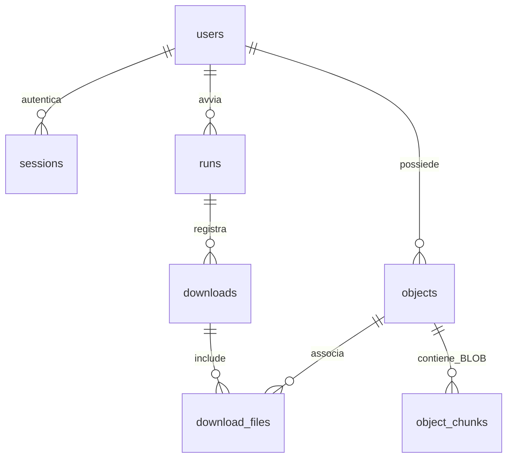

# SQLite, utenti DB e report PDF — 0.2.0

Estensione richiesta il 15 ottobre 2026. Gli utenti riguardano il database applicativo:
non sono account FAD e non sono account nativi SQLite. Tutti hanno gli stessi permessi;
non esiste un amministratore. Requisiti aggiunti: R26, R27 e R28.

## Dati e responsabilità

`users`: username univoco, salt e hash scrypt; nessun ruolo/admin.
`sessions`: hash del token casuale e scadenza di 8 ore.
`runs`/`downloads`: operazioni, esiti, corsi e risorse.
`objects`: proprietà, SHA-256 e dimensione, con deduplicazione per utente.
`object_chunks.data`: BLOB a blocchi di 1 MiB, compatibili anche con file grandi.
`download_files`: associa file principale e allegati alla singola operazione.

Il manifest JSON rimane lo stato del workspace. Il DB conserva una copia dei contenuti
e lo storico personale. Ogni risorsa è archiviata in una transazione: contenuti incompleti
o diversi dagli hash attesi producono rollback. Il filesystem non è una transazione SQLite:
se il DB fallisce, il file locale resta conservato e il task è marcato come ritentabile.
Schema SQLite iniziale: `PRAGMA user_version=1`; versioni sconosciute rifiutate.

## Utenti e accesso

Ogni accesso a storico, BLOB e report verifica il token della sessione e il proprietario.
SQL parametrizzato, nessuna password locale nel `.env` e nessun dato sensibile nei log.
Il login FAD resta separato e continua a usare il suo `.env`.
Il database demo è distinto dal database reale e contiene `studente1` e `studente2`,
entrambi ordinari. Nel DB reale gli utenti vengono registrati dall'interfaccia o dalla CLI.

SQLite non offre GRANT/REVOKE o utenti nativi. L'isolamento è applicativo e non cifra
il file: l'account del sistema operativo che possiede il DB può leggerlo direttamente.
Per protezione fra persone con accesso al computer servono anche account/permessi del sistema.

## GUI e CLI

Barra dedicata: registrazione, accesso e uscita utente DB, archivio BLOB, report PDF,
importazione dei download esistenti. Il cambio utente chiude le finestre del precedente archivio.
I download richiedono una sessione DB; scansione FAD e anteprima restano indipendenti.
La CLI aggiunge `user-add`, `db-history`, `db-import`, `restore-blob` e `report-pdf`.

## Report PDF

`pdf_reports.py` legge lo storico autenticato, produce un PDF ReportLab con utente,
data di generazione, conteggi, date UTC delle operazioni, corso/risorsa, esito, file e byte.
Supporta più pagine, intestazioni ripetute, font incorporati e escaping dei dati del DB.
Non incorpora i BLOB o le credenziali. I titoli lunghi vengono abbreviati nel PDF;
il dato completo resta nel database. Le importazioni sono riconoscibili come `importato`
e non ricostruiscono le date originali di download.

## Compatibilità e backup

I vecchi workspace restano utilizzabili; «Importa workspace» verifica i file registrati e
li associa all'utente DB connesso. File mancanti/modificati non vengono copiati nel DB.
Il backup del solo workspace non include il DB globale. Copiare anche SQLite a programma
chiuso o con uno strumento consapevole di WAL. Non condividere DB/PDF contenenti dati privati.

## Verifiche

Test automatici: due utenti senza admin, hash password e logout, isolamento degli oggetti,
sessioni contraffatte, SQL injection, BLOB sopravvissuti alla cancellazione locale,
corruzione e rollback, allegati, chunking, workspace di altro utente, importazione legacy,
errore DB senza perdita del file locale, PDF vuoto/personale/multipagina, escaping,
GUI e comandi CLI con due utenti. Test senza rete e con DB temporanei.

Prova dimostrativa: database con due utenti e report personale di due pagine,
generato con ReportLab e verificato tramite estrazione del testo e rendering di entrambe le pagine.
Nessun contenuto o credenziale reale della FAD è necessario per questa prova.

Esiti del 15 ottobre 2026: 120 test passati su Windows (1 saltato perché POSIX),
121 test passati su Ubuntu WSL con Xvfb (nessuno saltato). Ruff e Bandit senza segnalazioni.
Wheel 0.2.0 installato in un virtualenv Ubuntu separato; download demo e lettura dello storico
DB riusciti. Audit dipendenze runtime: nessuna vulnerabilità nota rilevata alla data della prova.
Il DB di esempio contiene 2 utenti, dati di tipo SQLite `blob`, 21 operazioni per `studente1`
e 3 per `studente2`; `PRAGMA integrity_check` restituisce `ok`.
PDF dimostrativo di 2 pagine renderizzato e controllato visivamente. Cattura grafica
Windows non disponibile durante la prova (desktop non accessibile); flussi GUI e geometria
dei pulsanti verificati tramite Tkinter e test automatici.
